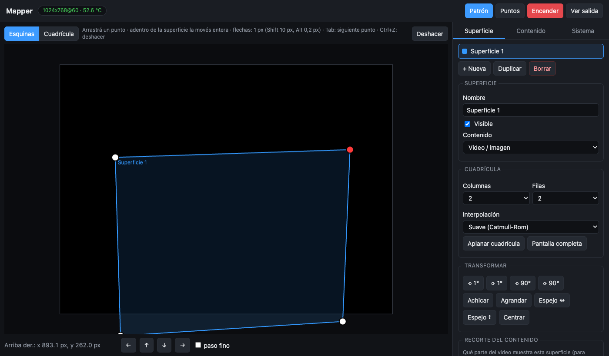
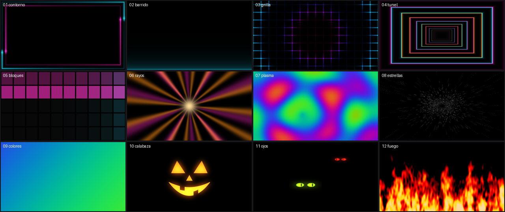

# RPi Mapper

**Turn an old Raspberry Pi 3 and any projector into a video mapping box you control from your phone.**

Plug in the projector, power the Pi, and about 24 seconds later it is projecting. Open its web page
from any phone or laptop on the same network to warp the image onto walls, boxes, facades or
pumpkins: drag the four corners, bend it with a grid, split one video across several faces.



## Why

Video mapping tools usually want a laptop and a GPU. A Raspberry Pi 3 is cheap and silent, and most
people have one in a drawer, but desktop mapping software doesn't run on it. RPi Mapper is built for
that hardware: a small C renderer that draws straight to the HDMI output (no desktop, no X), and a
web editor with no dependencies.

## What it does

- **Corners**: perspective-correct warping by homography. Drag a corner or the whole surface.
- **Grid**: 2×2 up to 9×9 control points with smooth (Catmull-Rom) or linear interpolation, for
  curved or uneven surfaces.
- **Up to 8 surfaces**, each showing its own crop of the same video, which is decoded only once. For
  example, three faces of a box, each one getting a third of the video.
- **Soft edges, opacity, brightness, contrast and gamma** per surface. Rotate, scale, mirror and center.
- **Calibration**: a test pattern on every surface, and the control points drawn on the projector
  itself so you can align them while looking at the wall. Arrow keys move a point 1 px, Shift moves
  it 10 px and Alt 0.2 px. Ctrl+Z undoes.
- **Playlist** of videos and images. A single video loops with no visible cut. Uploads are converted
  automatically to what the Pi can play (720p30 H.264, using the Pi's hardware encoder).
- **Off / On**: blacks out the projector and pauses the video, from the web page, the B key or a
  **physical push button** (see below).
- **Audio** over HDMI when the projector supports it (read from its EDID), otherwise from the 3.5 mm jack.
- **See the output**: a live capture of what the Pi is projecting, inside the editor.
- **Kiosk behaviour**: starts at boot, restarts itself if anything fails, hardware watchdog, logs
  kept in RAM to spare the SD card.

The interface is in Spanish.

## 13 ready-made loops

[`contenido/generar.py`](contenido/generar.py) generates the content: thirteen seamless 720p loops
designed for mapping, on black backgrounds (black means the projector puts out no light). There are
neon outlines that run around the edge of a surface, scanners, grids, a tunnel, blocks that light
up at 120 BPM, light rays, plasma, stars and color washes. For Halloween: a jack-o'-lantern, glowing
eyes in the dark, fire and a thunderstorm. It also makes a 4:20 mix of all of them with crossfades,
which loops without a cut. Everything is drawn by code, with no stock footage and no licensing
questions, and most clips weigh under 1 MB.



```sh
pip install numpy pillow            # and ffmpeg with libx264
python3 contenido/generar.py out/   # out/loop_01_contorno.mp4 ... out/mapping_mix.mp4
```

## What you need

- **Raspberry Pi 3** (model B, tested on rev 1.2) with **Raspberry Pi OS Lite 64-bit** (trixie). A
  Pi 4 or 5 should work and have headroom to spare, but they are untested.
- A projector over HDMI, and the Pi on your network (WiFi or Ethernet).
- Optional: a push button and two jumper wires.

## Install

On the Pi:

```sh
sudo apt-get install -y --no-install-recommends git build-essential pkg-config \
  libmpv-dev mpv libgbm-dev libegl-dev libgles-dev libdrm-dev libcjson-dev ffmpeg python3-libgpiod
git clone https://github.com/palmereta/rpi-mapper.git
cd rpi-mapper
sudo MODO=1280x720@60 sh system/optimizar.sh   # optional, see below
sudo sh instalar.sh
sudo reboot
```

Then open `http://<the Pi's IP>/` (or `http://mapper.local/`).

`instalar.sh` builds the renderer, creates a `mapper` system user, installs the two services and
starts them. Running it again updates the install and keeps your mapping and media.

`system/optimizar.sh` is **optional and opinionated**. It turns the Pi into a dedicated appliance:
it boots to console with no desktop, disables Bluetooth, printing, apt timers and other services,
keeps logs in RAM, enables the hardware watchdog, hides the boot text and cursor, renames the host
to `mapper`, and forces the HDMI output on at the `MODO` you pass (your projector's native mode,
the first line of `/sys/class/drm/card0-HDMI-A-1/modes`). On the original Pi 3, boot time went from
2:06 to 32 s. It backs up `config.txt` and `cmdline.txt` first (`.orig`). Read it before running it
on a Pi you also use for other things.

## Physical off button

Wire any normally-open push button between **pin 5 (GPIO3)** and **pin 6 (GND)** of the 40-pin
header. These two pins sit side by side near pin 1. No resistor is needed, because GPIO3 has a
pull-up on the board. Each press turns the image off or on. Off means black and paused, and it
resumes where it stopped.

## Using it

1. **Patrón** (pattern) and **Puntos** (points) put a calibration grid and the control points on the
   projector.
2. **Esquinas** (corners) mode: drag the four corners onto your surface. **Cuadrícula** (grid) mode:
   pick columns and rows and drag each point to follow curves.
3. **Contenido** tab: upload videos or images, build the playlist, set the volume and audio output.
4. **Sistema** tab: output resolution, temperature, export or import the mapping as JSON, restart.

Every change shows up on the projector on the next frame and is saved to the SD card one second after
you stop moving.

## How it works

```
 phone / laptop ──HTTP──▶ mapper-web (Python, stdlib only, port 80)
                            │  state.json on the SD card, uploads, ffmpeg conversions
                            ▼  UNIX socket (whole state as JSON)
                          mapper (C): DRM/KMS + GBM + EGL + OpenGL ES 2.0 ──▶ HDMI
                            └─ libmpv decodes (hardware H.264) into a texture;
                               each surface is a mesh (up to 48×48) built from its corners and grid
```

- The renderer redraws only when something changes: a new video frame or a moved point. A still
  image costs 0 % CPU.
- Measured on a Pi 3: 720p30 plays at a steady 30 fps using about 60 % of one core, at 63–71 °C,
  without throttling. **1080p does not fit**: it plays at 22 fps, which is why uploads are converted
  to 720p. The reason is that mpv cannot hand frames to the Pi 3's GPU without copying them (VC4
  lacks the `GL_EXT_texture_rg` extension that mpv's zero-copy path needs), and that copy is the
  bottleneck.
- Small HTTP API: `GET/PUT /api/state`, `GET/POST /api/blackout`, `GET/POST /api/player`,
  `GET/PUT/DELETE /api/media`, `GET /api/shot.png` (capture of the output) and `GET /api/info`.

## Limits and notes

- **No login.** Anyone on your network can open the editor. Use it on a network you trust.
- Content plays at up to 720p30. Anything bigger is converted when uploaded: a 20 s 1080p clip takes
  about 60 s to convert.
- If you plug in a projector after boot, use **Reiniciar renderer** (Sistema tab) to read its modes.
- Turning the image off is remembered across a power cut: if it was off, it boots off.

## License

[AGPL-3.0](LICENSE). Made by Alejandro Duarte.
